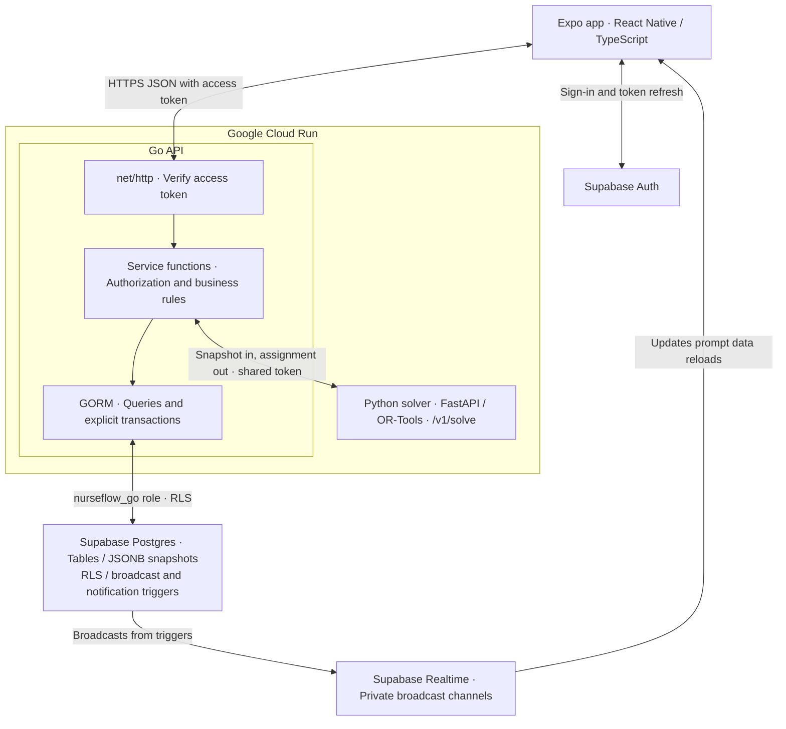

# NurseFlow

NurseFlow is a React Native mobile app built with Expo and TypeScript.

The app helps hospital charge nurses manage floor setup, shift assignments, patient acuity, nurse workloads, and related shift workflow.

## App Overview

NurseFlow is designed for charge nurses who need a clearer way to organize a hospital floor before and during a shift.

The app supports:

- Floor setup with rooms, beds, and doctor sides.
- Shift setup from a reusable floor template.
- Nurse profiles with license type, experience level, and max patient load.
- Patient entry with bed location, initials, age, sex, diagnosis, and acuity.
- Assignment logic that balances nurse teams, room coverage, and bed-level patient assignments.
- A compact charge nurse floor board for reviewing census, acuity, nurse workload, unassigned beds, and imbalance flags.

## Architecture

The Expo app signs in with Supabase Auth and sends every workflow read and write
to the Go API with the user's access token. Go checks the token, the user's role,
and resource access, then works on Postgres as a limited database role whose own
RLS policies scope every query to that user. For assignment runs, Go calls a
solver-only Python service. Supabase Realtime broadcasts, sent by database
triggers, tell the app when to reload.



The app has no direct table or RPC access for workflows. The only database paths
it still uses are Auth, Realtime broadcast authorization, and two deferred
notification paths that are off behind a feature flag. See
[ADR 0008](docs/adr/0008-clients-reach-data-only-through-go.md) for what was
retired and what was kept, and [hosted development](docs/go-migration/hosted-development.md)
for deployment and rollback.
## Setup

### Requirements

- Node.js installed.
- npm installed.
- A configured Supabase project and optimizer service.
- An Android emulator, iOS simulator, development build on a phone, or web browser.

### Install Dependencies

```bash
npm install
```

### Configure Environment

Copy `.env.example` to `.env` and set:

```dotenv
EXPO_PUBLIC_SUPABASE_URL=https://your-project-ref.supabase.co
EXPO_PUBLIC_SUPABASE_PUBLISHABLE_KEY=your-publishable-key
EXPO_PUBLIC_GO_API_URL=http://127.0.0.1:8080
```

Use the Supabase publishable key in the app. Database credentials and secret keys
belong only on the backend. The app reaches the assignment optimizer through
the Go API (`EXPO_PUBLIC_GO_API_URL`), so it needs no optimizer URL of its own.
Restart Expo after changing these values.

To run the Go API locally instead of a hosted one, follow the [backend instructions](backend/README.md).
See [Expo-to-Go setup](docs/go-migration/expo-template-read.md) for web origins and physical-device addresses.

For backend setup, see the [Supabase setup guide](docs/phase-5/supabase-auth-setup.md)
and [optimizer service instructions](optimizer-service/README.md).

### Start The App

```bash
npm start
```

Expo will show the available development targets.

### Useful Commands

```bash
npm run android
npm run ios
npm run web
npm run lint
```
