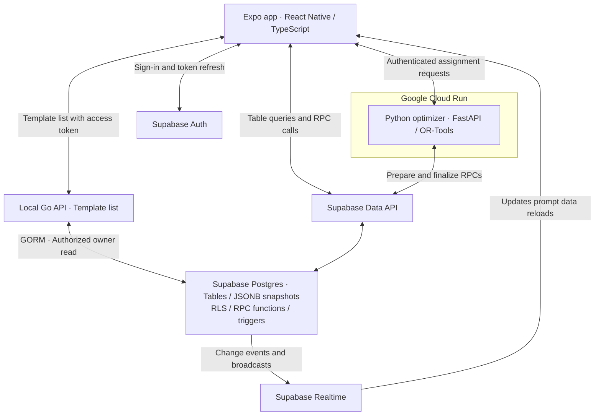
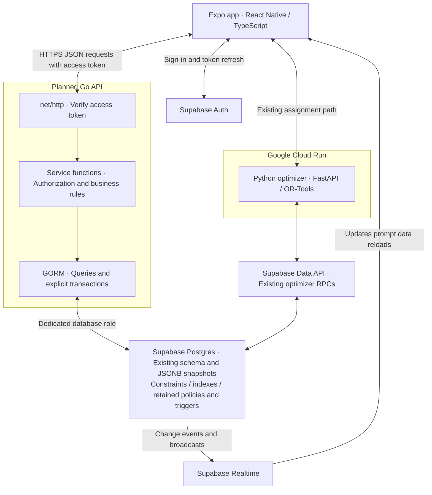

# NurseFlow

NurseFlow is a React Native mobile app built with Expo and TypeScript.

The app helps hospital charge nurses manage floor setup, shift assignments, patient acuity, nurse workloads, and related shift workflow.

## App Overview

NurseFlow is designed for charge nurses who need a clearer way to organize a hospital floor before and during a shift.

The app supports:

- Floor setup with rooms, beds, and doctor sides.
- Shift setup from a reusable floor template.
- Nurse profiles with license type, experience level, and max patient load.
- Patient entry with bed location, initials, age, sex, diagnosis, and acuity.
- Assignment logic that balances nurse teams, room coverage, and bed-level patient assignments.
- A compact charge nurse floor board for reviewing census, acuity, nurse workload, unassigned beds, and imbalance flags.

## Architecture

### Current architecture

The Expo app uses Supabase Auth for login and accesses application data through
Supabase's Data API. On the Go migration branch, floor-template list reads use
the local Go API; other reads and writes keep their existing paths. Postgres
holds the data, RLS policies, PL/pgSQL workflow
functions, and triggers. A separate Python optimizer runs on Google Cloud Run.



### Planned Go architecture

The planned Go API uses `net/http` for HTTP handling, service functions for
authorization and business logic, and GORM for Postgres access. Supabase Auth,
Realtime, and the Python optimizer remain separate services. The local template-list endpoint is implemented; the broader workflow migration remains planned.



## Setup

### Requirements

- Node.js installed.
- npm installed.
- A configured Supabase project and optimizer service.
- An Android emulator, iOS simulator, development build on a phone, or web browser.

### Install Dependencies

```bash
npm install
```

### Configure Environment

Copy `.env.example` to `.env` and set:

```dotenv
EXPO_PUBLIC_SUPABASE_URL=https://your-project-ref.supabase.co
EXPO_PUBLIC_SUPABASE_PUBLISHABLE_KEY=your-publishable-key
EXPO_PUBLIC_GO_API_URL=http://127.0.0.1:8080
```

Use the Supabase publishable key in the app. Database credentials and secret keys
belong only on the backend. The app reaches the assignment optimizer through
the Go API (`EXPO_PUBLIC_GO_API_URL`), so it needs no optimizer URL of its own.
Restart Expo after changing these values.

For the migration branch, start the local Go API using the [backend instructions](backend/README.md).
See [Expo-to-Go setup](docs/go-migration/expo-template-read.md) for web origins and physical-device addresses.

For backend setup, see the [Supabase setup guide](docs/phase-5/supabase-auth-setup.md)
and [optimizer service instructions](optimizer-service/README.md).

### Start The App

```bash
npm start
```

Expo will show the available development targets.

### Useful Commands

```bash
npm run android
npm run ios
npm run web
npm run lint
```
